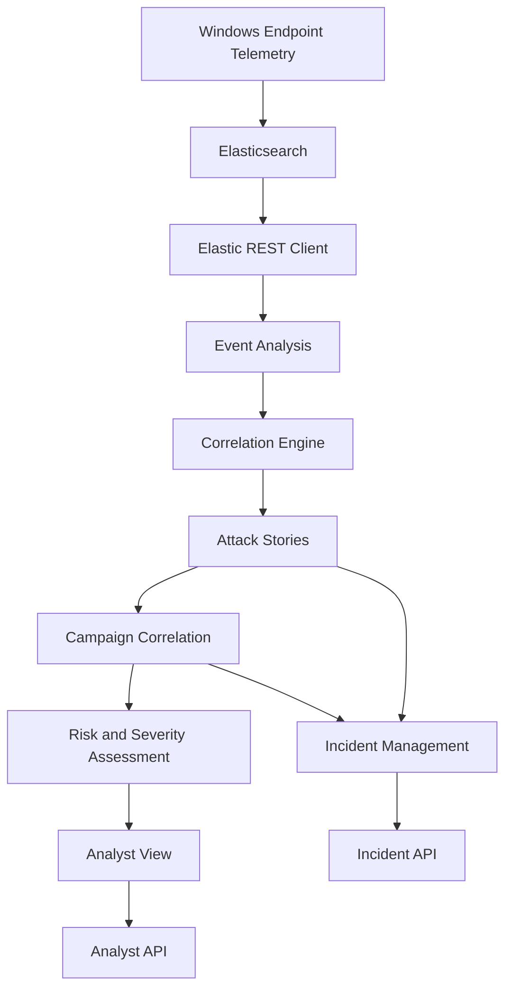

# THREATWEAVE

**Attack Correlation & Incident Response Platform**
*Weaving endpoint telemetry into actionable attack intelligence.*

---

## Overview

**THREATWEAVE** is an Elastic-integrated cybersecurity platform designed to correlate endpoint telemetry into structured attack stories and multi-stage campaigns, evaluate risk, and support analyst-driven incident investigation and management workflows.

By retrieving Windows endpoint telemetry from Elasticsearch and applying deterministic event correlation, THREATWEAVE bridges the gap between raw endpoint events and structured attack intelligence.

The platform exposes investigation-focused and incident-management REST APIs to support security analysts during triage, attack reconstruction, and case tracking.

---

## Core Capabilities

- **Endpoint Event Correlation:** Links related Windows endpoint telemetry events using correlation logic and available evidence.
- **Attack Story Reconstruction:** Organizes correlated events into chronological attack stories.
- **Process Chain Analysis:** Provides process relationship visibility based on available endpoint telemetry.
- **Campaign Correlation:** Groups related attack stories into broader operational campaigns.
- **Risk and Severity Assessment:** Evaluates correlated activity to assign contextual risk and severity levels.
- **MITRE ATT&CK Context:** Provides tactic and technique context for observed behaviors.
- **IOC Exploration:** Extracts and exposes Indicators of Compromise (IOCs) associated with correlated activity.
- **Incident Management:** Supports incident lifecycle tracking, status updates, analyst notes, and story/analysis ingestion.
- **Analyst-Facing REST APIs:** Provides FastAPI-powered services for querying correlation outputs and managing incidents.

---

## Architecture

THREATWEAVE follows a pipeline that transforms endpoint telemetry into structured investigation data and incident-management workflows.



### Workflow Stages
1. Telemetry Retrieval: Windows endpoint telemetry stored in Elasticsearch is queried through the Elastic REST Client (collector/elastic_client.py).
2. Event Analysis and Correlation: Available events are analyzed and linked by the correlation engine into structured attack stories.
3. Campaign Correlation: Related stories are grouped into broader campaign-level representations.
4. Risk Assessment: Correlated activity receives risk and severity context alongside MITRE ATT&CK information.
5. Analyst Investigation: Generated intelligence is exposed through the analyst view and Analyst API.
6. Incident Management: Stories and analysis results can be ingested into the incident-management layer for investigation and lifecycle tracking.

## Technology Stack

| Component | Technology |
|---|---|
| Programming Language | Python |
| API Framework | FastAPI |
| ASGI Server | Uvicorn |
| Data Validation | Pydantic |
| Telemetry Search and Storage | Elasticsearch |
| Elasticsearch Integration | Elasticsearch Python Client |
| Data Source | Windows Endpoint Telemetry |
| Evaluation | JSON-based evaluation pipeline |


## Project Structure

```text
THREATWEAVE/
├── analyst_api.py
├── analyst_view.html
├── collector/
│   └── elastic_client.py
├── documentation/
│   ├── evaluation/
│   └── system_state/
├── evaluation/
│   ├── evaluation_dataset.json
│   ├── ground_truth.json
│   ├── engine_output.json
│   ├── evaluation_report.json
│   ├── evaluate_engine.py
│   ├── run_engine_evaluation.py
│   └── render_screenshot_reports.py
├── incident_api.py
├── incident_manager_v4.py
├── requirements.txt
└── README.md


```

## Getting Started
### Prerequisites
- Python 3.x
- Access to an Elasticsearch instance containing Windows endpoint telemetry for full telemetry collection and engine evaluation workflows.
- The Incident API can run independently in demo mode using an in-memory incident store.
### Installation
Clone the repository:
git clone <YOUR_REPOSITORY_URL>
cd attack-correlation-engine


Create and activate a virtual environment:
python3 -m venv venv
source venv/bin/activate


Install dependencies:
pip install --upgrade pip
pip install -r requirements.txt


### Elasticsearch Configuration
Configure the Elasticsearch connection using the environment variables expected by the application.

The full correlation workflow requires a reachable Elasticsearch instance and appropriate credentials.

### Running the Services
1. Analyst API
The Analyst API reads its presentation data from the analyst_view/ directory.

Start the service:
ANALYST_VIEW_DIR=analyst_view uvicorn analyst_api:app --reload


- Default Port: 8000
- Data Source: analyst_view/
The directory must contain the generated analyst-view data required by the API.
2. Incident API
The Incident API supports an in-memory demo workflow through DEMO_MODE.

Start the service:
DEMO_MODE=true uvicorn incident_api:app --reload --port 8001


- Default Port: 8001
- Demo Storage: In-memory incident store.
- Elasticsearch Requirement: Not required for this demo workflow.
Run each API in a separate terminal.

Interactive API documentation is available through FastAPI Swagger UI at:
- Analyst API: http://127.0.0.1:8000/docs
- Incident API: http://127.0.0.1:8001/docs

## API Overview
Analyst API (analyst_api.py)
Provides investigation-oriented endpoints for:
- Campaign listing and campaign details.
- Attack story retrieval.
- Related event inspection.
- Process-chain information derived from available telemetry.
- Indicators of Compromise (IOCs).
- Platform statistics.
- Service health monitoring.
Incident API (incident_api.py)
Provides incident-management functionality:
- Incident listing and details.
- Incident summaries.
- Incident status updates.
- Analyst notes.
- Story ingestion.
- Analysis-result ingestion.
- Demo incident seeding.
- Service health monitoring.
The incident-management layer supports analyst workflows and case tracking. It does not autonomously execute containment or remediation actions.

## Evaluation & Benchmarks
### Independent Attack Analysis

An independent analysis of the LokiBot-related Sysmon dataset used in THREATWEAVE's evaluation. It documents the observed attack activity, execution timeline, network indicators, benign background activity, potential false-positive scenarios, and investigation limitations.

This analysis establishes the contextual understanding of the dataset and its ground truth, independently of the correlation engine's output.

See the full [Independent Attack Analysis](evaluation/attack_analysis.md).

### Dataset Composition
The correlation engine is currently evaluated against a structured benchmark dataset:
- Total Endpoint Events: 472
- Attack-Labelled Events: 56
- Scenario Scope: 1 attack scenario
Dataset files:
- evaluation/evaluation_dataset.json
- evaluation/ground_truth.json
### Evaluation Execution
Run the evaluation scoring script:
python evaluation/evaluate_engine.py


Render the evaluation results:
python evaluation/render_screenshot_reports.py


The engine evaluation workflow is separate from offline scoring and may require a configured Elasticsearch connection and the appropriate runtime environment.
### Benchmark Results
| Metric | Result |
|---|---:|
| Relationship Precision | 78.83% |
| Relationship Recall | 66.73% |
| Overall Relationship F1 | 72.28% |
| Core Attack Pair F1 | 54.82% |
| Campaign Purity | 100.00% |
| Campaign Cleanliness | 41.18% |
| Composite Evaluation Score | 59.68% |

### Interpretation & Evaluation Caveats
- Campaign Purity: A score of 100% does not mean the campaign is free of benign events. It indicates that the evaluated attack events captured in the largest relevant campaign belong to the same ground-truth attack campaign.
- Campaign Cleanliness: The score of 41.18% reflects campaign-level separation quality and the presence of benign events grouped alongside malicious activity.
- Composite Score: The score of 59.68% is a weighted aggregate of evaluable components. It does not represent overall classification accuracy.
- Limited Generalization: Current metrics are derived from one attack scenario across 472 events. They should not be extrapolated to claim generalization across diverse attack techniques, threat actors, or enterprise environments.

## Scope & Limitations
- Not a SIEM or EDR Replacement: THREATWEAVE operates as a correlation and incident-workflow layer on top of existing telemetry infrastructure.
- No Autonomous Remediation: The platform supports human-in-the-loop incident management and does not automatically isolate hosts, terminate processes, or execute containment actions.
- Deterministic Correlation: The current platform uses rule-based and heuristic correlation logic rather than machine-learning-based anomaly detection.
- Telemetry Dependency: Correlation quality depends on the completeness, consistency, and quality of available endpoint telemetry.
- False Positives and Missed Relationships: Correlated stories and campaigns may include benign events or omit true attack relationships, as reflected in the evaluation results.
- Single-Scenario Validation: Current quantitative validation is restricted to one evaluated attack scenario.
- Process Relationship Limitations: Process relationships depend on the available telemetry and should not be interpreted as guaranteed reconstruction of every process execution relationship.

## Roadmap & Future Improvements
- Dataset Expansion: Incorporate additional attack scenarios and larger telemetry datasets.
- Correlation Tuning: Improve relationship precision and recall while reducing false-positive correlations.
- Campaign Separation: Improve campaign cleanliness and reduce benign event inclusion.
- Telemetry Coverage: Expand support for additional endpoint event types and telemetry sources.
- Investigation Workflows: Improve analyst triage and incident-management capabilities.
- Automated Testing: Introduce comprehensive integration and regression tests across the platform.
